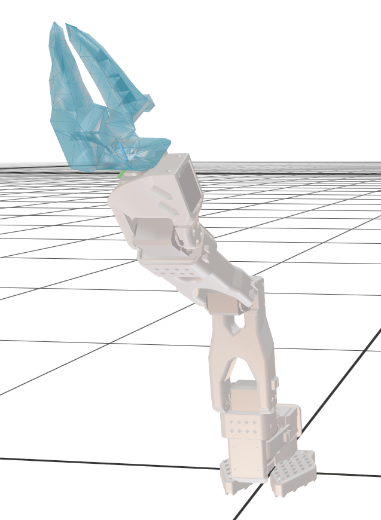
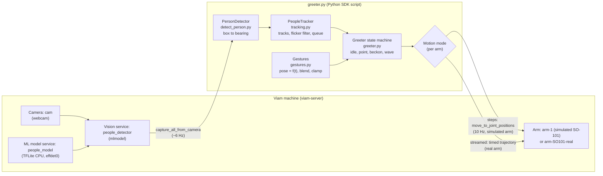
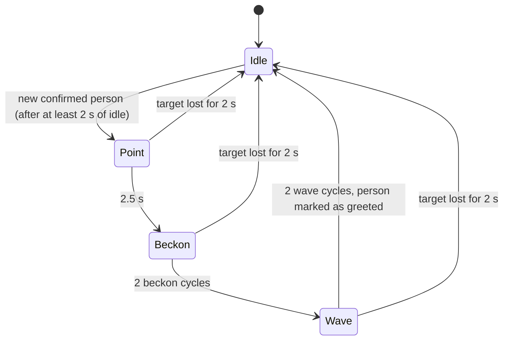

<p align="center">
  
</p>

<h1 align="center">ViamGreeter</h1>

Greeter is an autonomous booth greeter built on the [Viam](https://www.viam.com/) platform. Using a fixed webcam and a pre-trained model to detect and track people passing by a trade show booth, Greeter directs an SO-101 robotic arm to engage with each passerby. The arm turns toward them, points, beckons them over, and waves before moving on to the next person.

It runs on Viam's simulated SO-101 arm and on a real SO-101 arm which can be chosen via a setting in `.env`. The default is a simulated arm.

---

## Table of contents

1. [Problem statement and goals](#1-problem-statement-and-goals)
2. [Approach](#2-approach)
3. [Demo](#3-demo)
4. [System architecture](#4-system-architecture)
5. [Design decisions](#5-design-decisions)
6. [How the requirements are met](#6-how-the-requirements-are-met)
7. [Repository structure](#7-repository-structure)
8. [Setup and usage](#8-setup-and-usage)
9. [Moving to a real robot](#9-moving-to-a-real-robot)
10. [Shortcomings and proposed solutions](#10-shortcomings-and-proposed-solutions)
11. [Future improvements](#11-future-improvements)

---

## 1. Problem Statement and Goals

> It's day two of a trade show. The booth staff have been standing for nine hours, their voices are gone, and the coffee ran out at noon. Meet Greeter: a robotic arm at the front of the booth that notices people walking by, turns to acknowledge them, gives them a moment of attention, and then moves on to the next passerby so the humans can sit down for a minute.

Using the Viam Python SDK, write a script with a control loop that lets Greeter:

| # | Requirements |
|---|---|
| Req.1 | Look for people using the camera and a machine learning model, and orient the arm towards them |
| Req.2 | Hold on a person for a moment so they feel acknowledged |
| Req.3 | Behave sensibly when nobody is walking by, and keep running when detections drop out or flicker |
| Req.4 | Try not to get stuck or crash when asked to move somewhere the arm can't reach |

The README must also state:

| # | Question | Answered in |
|---|---|---|
| Q1 | Where the camera sits relative to the arm | [§5.1](#51-camera-placement) |
| Q2 | How a detection in the image maps to an arm command, and why | [§5.2](#52-mapping-a-detection-to-an-arm-command) |
| Q3 | What I'd do differently on a real arm | [§9](#9-moving-to-a-real-robot) |

**My goals beyond the brief:** make the greeting read clearly to a passerby (point, then beckon, then wave), keep every motion smooth, add in a gentle swaying idle sequence, and make the code structured so it could become a deployable Viam module.

---

## 2. Approach

<!-- Fill in with your own words: how you broke the problem down, what you tried first, what changed along the way. -->

> **[Your notes]** *How I broke the problem down, and the order I tackled it in.*

The work went in stages, each tested on the machine before moving on:

1. **Detection.** Configure the webcam and the effdet0 people detector, then turn bounding boxes into directions in the robot's frame (`detect_person.py`).
2. **Tracking test.** Turn only the base joint towards the closest person, to check the whole chain from camera to arm (a standalone test script, kept as a local tool and not part of this repo).
3. **Behaviour.** Design the gestures as functions of time, add a state machine and a tracker with a queue, and tune the motion in the 3D scene (`greeter.py`, `gestures.py`, `tracking.py`).
4. **Real hardware.** Port to a physical SO-101, diagnose the gap between simulation and the real arm, and restructure how motion reaches the arm (see [§9](#9-moving-to-a-real-robot)).

> **[Your notes]** *What I'd tell another developer learning this, and where I got stuck.*

### Notes and sketches

<!-- Drop photos/scans into media/images/ and update the paths below. -->

| | |
|:---:|:---:|
| **[Image placeholder]** `media/images/notes-1.jpg` | **[Image placeholder]** `media/images/notes-2.jpg` |
| *Caption: initial system sketch* | *Caption: camera-to-arm mapping* |

<!--
Replace the table above with images once uploaded, e.g.:
|  |  |
-->

---

## 3. Demo

<!--
Inline playback: GitHub only plays videos inline in a README when they're uploaded through
github.com. Edit this README on GitHub, drag media/videos/<file> into the editor at the
INLINE PLAYER marker, and GitHub inserts a https://github.com/user-attachments/assets/... link
that renders as a player. The links below open the copies committed in this repo.
-->

### Simulated SO-101 (Viam 3D scene)
[Simulated SO-101](https://github.com/user-attachments/assets/957f2d4b-a655-4539-b3ad-b83c1ff9707a)

**[Watch the simulation demo](media/videos/greeter_sim.mp4)** (`media/videos/greeter_sim.mp4`)

The video opens on the **idle behaviour**: a slow, gentle scanning sway that dips above and below horizontal while the camera watches for passersby. When a person is detected, Greeter:

1. **Points** at them with an outstretched arm for **2.5 seconds**, so it's obvious who is being greeted.
2. **Beckons** them over **twice**: the hand reaches low towards them and curls up and back.
3. **Waves** at them with a raised hand.
4. **Transitions smoothly back** into the gentle idle sway, picking up from wherever the arm is.

Throughout the greeting, the base **keeps tracking the person** as they move.

*Not pictured:* Greeter keeps a **queue** of everyone it has seen and greets them one at a time, closest first. It **never greets the same person twice**, unless they leave the scene for **more than 3 seconds** and come back, in which case they're treated as a new visitor.

> **[Your thoughts]** *Add your own commentary on the simulation run: what you were testing, what you're pleased with, what you'd tune.*

### Real SO-101

[Real SO-101](https://github.com/user-attachments/assets/657e7ac3-a07f-4b7f-a611-5bbc258ccf20)

**[Watch the real-arm demo](media/videos/greeter_real.mp4)** (`media/videos/greeter_real.mp4`)

The physical SO-101 runs the same Greeter behaviour (idle, point, beckon, wave, back to idle), driven by the same code. The differences are the real-arm settings described in [§9](#9-moving-to-a-real-robot):
- motion is **streamed** as one continuous, timed trajectory instead of separate moves;
- the wave uses a **bent-elbow pose** to reduce servo rattle;
- the wrist roll is set to make the gripper read as a hand.

Some fine shimmer remains; that's the limit of the hobby servos (see [§9.3](#93-final-real-arm-settings)).

> **[Your thoughts]** *Check this description matches the video, and add your own commentary: how the real arm compared with the simulation, and what surprised you.*

---

## 4. System architecture

### 4.1 Block diagram



Two loops run at the same time in one asyncio program:

- **Perception (~6 Hz):** camera → detector → tracker. The camera is fixed, so it keeps watching while the arm moves.
- **Motion (10 Hz):** the state machine picks the active motion, samples it at the current time, blends across switches, clamps to joint limits, and sends the pose to the arm.

### 4.2 Behaviour state machine



| State | What the arm does |
|---|---|
| **Idle** | Slow scanning sweep: the base moves ±30° while the shoulder, elbow and wrist bob on different rhythms, so the hand dips above and below horizontal. It repeats only every 126 s. |
| **Point** | Arm stretched out level towards the person, so it's obvious who is being greeted. |
| **Beckon** | Hand low and forward. The elbow and wrist move a quarter cycle apart, so the hand traces a loop and curls up and back: "come over here". |
| **Wave** | Hand raised. The base sways ±10° while the wrist rocks. |

In every greeting state, the base keeps following the person as they walk.

---

## 5. Design decisions

### 5.1 Camera placement

**Assumption:** the webcam is mounted **at the base of the arm, fixed to the pedestal** (it doesn't rotate with joint 1), with its optical axis along the arm's **+x** direction (base 0°) and its image "up" along +z.

Why a fixed camera instead of one on the wrist:

- **Pixels map directly to directions.** A pixel always means the same direction in the world, whatever the arm is doing. A wrist camera would see the whole scene shift every time the arm moved, and every detection would need correcting for that.
- **It keeps watching while greeting.** Greeter can follow the current person and queue up the next one *while* it waves.
- **It's simpler.** There's no need to model a moving viewpoint or to keep an estimate of every person's position while the camera moves.

### 5.2 Mapping a detection to an arm command

Each person's bounding-box centre `(u, v)` becomes a **bearing** with a pinhole camera model. The focal length in pixels comes from the camera's horizontal field of view (`CAMERA_HFOV_DEG`, 70° for a Logitech C920 at 16:9):

```
f        = (W / 2) / tan(HFOV / 2)
bearing  = -atan((u - W/2) / f)      # + = left of +x (counter-clockwise), world frame
base     = -bearing                  # SO-101: positive base angle turns clockwise
```

The base joint's sign was measured on the arm: at base +30°, the end of the arm moves towards −y. Elevation is computed the same way from `v`, but not used yet.

**Why this mapping:**

- **Only the base needs to aim.** With a camera at the base, "orienting towards a person" is a rotation about the vertical axis, and the base joint gives exactly that.
- **It works with any resolution or camera.** Image size is read from every frame, so a different camera only needs its field of view (and `MIRRORED`, if the image is flipped).
- **Joint space instead of Cartesian targets.** A single webcam gives direction but no distance, so a 3D target position would be invented. Commanding joint angles directly avoids inverse kinematics and motion-planning failures. After clamping to the joint limits, every command is reachable by construction.

### 5.3 Motions as functions of time

Idle, point, beckon and wave are each a plain function `pose = f(t)` in `gestures.py`. Ten times a second, the controller asks the active motion where the arm should be *now*. This gives:

- **Instant interruption.** Idle is only sampled, never left running, so it can stop the moment someone appears.
- **Smooth trajectories between gestures.** Every change in gesture (idle, point, beckon, or wave) blends from the arm's actual pose using a smoothstep curve, which starts and ends gently. Returning to idle resumes at the point on the idle path nearest the arm's current pose, so the arm never swings across to a distant point.
- **Continuous tracking.** The person's bearing feeds into every gesture.
- **Safety in one place.** Every pose passes through `clamp_pose()`: joint limits from the arm's kinematics, minus a 5° margin, with the shoulder further capped so the arm never reaches down into the table. 
- **Speeds checked offline.** Each gesture is designed to stay under the arm's speed limit.

### 5.4 Tracking and the greeting queue

The detector only reports "a person at this bearing" each frame; it doesn't know *which* person. `tracking.py` gives people an identity by matching each frame's detections to existing tracks by nearest bearing (within 12°).

| Rule | Value | Purpose |
|---|---|---|
| Confirm a new track | 3 frames (~0.5 s) | Ignore one-frame false detections |
| Eligible to greet | confirmed, not yet greeted, seen in the last 0.6 s | Never turn towards someone who just left |
| Queue order | Closest first (largest box), re-checked every time | Prioritise people near the booth |
| Between greetings | At least 2 s of idle | Make "moving on" visible |
| Target lost mid-greeting | Not seen for 2 s → end the greeting, mark as greeted | Don't wave at empty space |
| Forget a track | Not seen for 3 s | Survive flicker and brief occlusion |
| Greeted and still present | Never greeted twice | Move on to the next person |

---

## 6. How the requirements are met

| Requirement | Implementation | Where |
|---|---|---|
| **11** Look for people and orient towards them | effdet0 via the `people_detector` vision service. Each box becomes a bearing, then a base angle, smoothed every tick. | `detect_person.py`, `greeter.py` (`desired_pose`) |
| **2** Hold on a person | Point (2.5 s), then two beckons, then two waves, about 17 s per person, while the base follows them | `greeter.py`, `gestures.py` |
| **3** Sensible when nobody is there | Slow scanning idle that never repeats exactly. Resumes from wherever the arm is. | `gestures.idle_pose`, `Greeter.start_idle` |
| **3** Robust to dropouts and flicker | 3-frame confirmation, 3 s track memory, 2 s loss tolerance mid-greeting. Detection errors are logged and the loop continues. | `tracking.py`, `Greeter.perceive` |
| **4** Don't get stuck on unreachable poses | Joint-space commands only (no inverse kinematics to fail), clamped to the kinematic limits with a 5° margin and a table-safe shoulder cap | `gestures.clamp_pose` |
| **4** Don't crash | Every arm call has a timeout. Failures trigger a guarded recovery (stop, re-read the pose) with increasing back-off. The start pose is read with retries. Tested with a fake arm where 30% of calls fail. | `Greeter.recover`, `Greeter.run` |
| Uses the Viam Python SDK | `viam-sdk` 0.85: `RobotClient`, `Arm`, `VisionClient` | all |
| Simulated arm, webcam, people detector | Simulated SO-101, webcam `cam`, TFLite effdet0 + mlmodel vision service | [§8.2](#82-machine-configuration) |

---

## 7. Repository structure

```
ViamGreeter/
├── greeter.py          # Main program: the control loop and state machine
├── gestures.py         # Motions as pose = f(t); blending, clamping, joint limits
├── tracking.py         # Turns detections into tracks; flicker filter; greeting queue
├── detect_person.py    # Vision service → people with bearings; runnable live viewer
├── connect.py          # Connects to the machine using credentials from .env
├── requirements.txt    # Python dependencies
├── media/
│   ├── images/         # Header image, notes and sketches
│   └── videos/         # Demo videos
└── problem_statement.txt
```

| File | Summary |
|---|---|
| **`greeter.py`** | Entry point. The `Greeter` class runs two concurrent loops: **perception** (detector → tracker) and **motion** (state machine → arm). It handles the phases (idle, point, beckon, wave), the motion clock, blending between phases, and settings for each arm (motion mode, wrist roll, wave pose). It sends motion either as 10 Hz single moves (`steps`) or as one continuous timed trajectory (`streamed`), and recovers from arm errors without crashing. |
| **`gestures.py`** | Pure functions with no SDK dependency. They return 5 joint angles `[base, shoulder, elbow, wrist pitch, wrist roll]` for a given time: `idle_pose`, `point_pose`, `beckon_pose`, `wave_pose`. Also holds the joint limits and `clamp_pose`, the `smoothstep` blending, and `nearest_idle_time` for resuming idle smoothly. Joint directions were measured on the arm and are documented in the file. |
| **`tracking.py`** | `PeopleTracker` matches each frame's detections to `Track`s by bearing, confirms new tracks, forgets stale ones, keeps the `greeted` flag, and returns `next_target()`, the closest eligible person. |
| **`detect_person.py`** | `PersonDetector.detect()` gets one image and its detections from the vision service in a single call, keeps confident `person` detections, and converts each to bearing and elevation with `pixel_to_direction()`. Run it directly to print live detections and per-frame latency. |
| **`connect.py`** | `connect()` reads the API key and machine address from `.env`. Run it directly to list the machine's resources as a connection check. |

---

## 8. Setup and usage

### 8.1 Prerequisites

- Python 3.11+ (developed on 3.14)
- A Viam machine running `viam-server` on the computer the webcam is plugged into
- A webcam, and optionally a physical SO-101 arm

### 8.2 Machine configuration

Configure these in the Viam app (**CONFIGURE** tab). The code looks resources up **by name**, so the names must match.

| Name | Type | Model / notes |
|---|---|---|
| `cam` | Camera | `webcam`; set `video_path` if it isn't detected automatically |
| `people_model` | ML model | **TFLite CPU**, deploying the **effdet0** model from the registry |
| `people_detector` | Vision | **`vision/mlmodel`** block. ML model: `people_model`, default camera: `cam` |
| `arm-1` | Arm | Simulated SO-101 (from the `devrel/so101-arm` module) |
| `arm-SO101-real` | Arm | *Optional.* Physical SO-101 (same module); see [§9.3](#93-final-real-arm-settings) |

<!-- Recommended: export the machine config JSON (minus secrets) and commit it, e.g. config/machine.json. -->

### 8.3 Install

```bash
git clone git@github.com:cameron-lerch/ViamGreeter.git
cd ViamGreeter
python3 -m venv .venv
source .venv/bin/activate
pip install -r requirements.txt
```

Create a `.env` file in the project folder. Find the key and address in the machine's **CONNECT** tab.

```bash
VIAM_API_KEY=<api key>
VIAM_API_KEY_ID=<api key id>
VIAM_MACHINE_ADDRESS=<machine>.viam.cloud
GREETER_ARM=arm-1            # or arm-SO101-real
GREETER_SPEED=1.0            # optional: 0.5 = half-speed gestures (e.g. first real-arm run)
# GREETER_MOTION=streamed    # optional: override the arm's default motion mode (steps | streamed)
```

`.env` is in `.gitignore`, so credentials never get committed.

### 8.4 Run

```bash
python3 connect.py          # 1. connection check: lists the machine's resources
python3 detect_person.py    # 2. live detections: step to your right, and the bearing should go positive
python3 greeter.py          # 3. the full Greeter (Ctrl-C stops the arm)
```

Watch the arm in the app's **3D SCENE** tab. Run **one script at a time**: two scripts commanding the same arm cancel each other's moves.

### 8.5 Tuning

| Setting | File | Default | Effect |
|---|---|---|---|
| `CAMERA_HFOV_DEG`, `MIRRORED` | `detect_person.py` | 70°, `False` | Camera model; set these when changing webcams |
| `MIN_CONFIDENCE` | `detect_person.py` | 0.5 | Detection threshold |
| `POINT_S`, `TRANSITION_S`, `WAVE_BLEND_S` | `greeter.py` | 2.5 s, 1.5 s, 1.2 s | Greeting timing |
| `MIN_IDLE_S`, `LOST_S`, `BASE_FOLLOW` | `greeter.py` | 2 s, 2 s, 0.2 | Pacing and how closely the base follows |
| `MATCH_GATE_DEG`, `CONFIRM_HITS`, `FORGET_S` | `tracking.py` | 12°, 3, 3 s | Tracking and flicker tolerance |
| Poses and periods (`POINT`, `RAISED`, `REACH`, `IDLE_CENTER`, ...) | `gestures.py` | | Gesture shape |

---

## 9. Moving to a real robot

I initially expected the move from simulation to a real arm to need **some tuning**: speeds, timings, maybe a few poses. What I didn't expect was a **structural change in how the code sends motion to the arm**. The real arm needed continuous streams of waypoints instead of one target at a time.

### 9.1 What happened

| Symptom on the real SO-101 | Root cause | Fix |
|---|---|---|
| Very jittery; joints sometimes moved one at a time; slow | The motion loop sent a new target **10 times a second**. The simulated arm accepts each one instantly, but on the real arm each `MoveToJointPositions` is a complete move that starts and ends at rest. I measured a median of **258 ms per command**, so only 17 of 40 commands were sent in a 4 s wave, each a stop-start. | Added a **`streamed`** motion mode: the same poses are sent as one continuous, **timestamped trajectory** (`move_through_joint_positions_streamed`), 0.3 s ahead. The arm moves through them without stopping. A lag test showed the real arm follows the stream within **0.15–0.2 s**, with no backlog. |
| The arm module kept **dropping bytes** from the servos (`communication error during sync_read: read 40 of 48 expected bytes`), and joint reads and moves failed | **USB contention.** The webcam was plugged into the **same USB dongle** as the arm's serial adapter. The 1080p video stream filled the shared USB link, so replies from the servo bus arrived incomplete and the module timed out. The servo bus was the victim, not the cause. | Moved the webcam to **its own USB port**, and the errors stopped. Hardware layout matters as much as code. |
| Greeter **crashed** after one of those bus errors | My bug: after a failed move, the recovery code (`stop()`, then re-reading the joints) went to the same failing bus, and nothing caught its exception | Recovery now never raises, backs off as failures repeat, and retries reading the start pose. Tested with a fake arm where 30% of calls fail. |
| Shaking at the top of the wave | With the arm straight up, gravity puts almost no load on the servos, so **gear backlash** rattles over a long lever | A real-arm-only **bent-elbow wave pose**: forearm tilted forward, hand still up |
| The hand looked wrong | Wrist roll zero differs between the simulated and real arm | Wrist roll for each arm: 90° in simulation, 0° on the real arm |

All real-arm differences are keyed to the **arm name** (`HAND_ROLL_BY_ARM`, `WAVE_RAISED_BY_ARM`, `MOTION_BY_ARM` in `greeter.py`). The simulated arm keeps its original behaviour, and `GREETER_ARM` is the only switch.

### 9.2 Lessons

- A simulation hides assumptions. Here it hid **command rate, bus bandwidth and acceleration**. The simulated arm also ignored speed limits, which hid how fast I was really driving it.
- On real hardware, prefer **fewer, richer commands** (timed trajectories) over many small ones.
- **Hardware layout is part of the system.** A webcam on the same USB dongle as the servo adapter was enough to corrupt servo communication. Give high-bandwidth devices their own USB controller.
- **Error handling has to assume the recovery calls can fail too.**
- Check the **module and server logs** (`viam-agent`), not only the client error. They pointed at the servo bus.
- Keep the simulated arm configured next to the real one, so changes can always be checked against simulation.

### 9.3 Final real-arm settings

SO-101 arm module attributes that gave the best motion:

```json
{
  "port": "/dev/ttyACM1",
  "speed_degs_per_sec": 120,
  "waypoint_lookahead_deg": 20,
  "acceleration_degs_per_sec_per_sec": 500
}
```

The port varies by machine. The remaining fine shimmer comes from the hobby servos themselves, which only accept goal positions and have some gear backlash.

### 9.4 What I'd do differently on a real arm

- **Measure where the camera is instead of assuming it.** Record its pose in Viam's frame system and use the measured offset and rotation in the mapping. Ideally move the camera off the arm's axis or up higher, so the arm never blocks its view of the person mid-gesture.
- **Safety first:**
  - lower speed and acceleration near people;
  - workspace obstacles (table, booth furniture) given to the motion service;
  - a physical emergency stop;
  - a slower first run (`GREETER_SPEED=0.5` exists for this).
- **Deploy as a Viam module** (a generic service) on the computer next to the arm, so `viam-server` supervises it, restarts it after crashes or reboots, ships it to every booth from the registry, and exposes its settings in the app.
- **Plan the hardware layout:** separate USB controllers or a powered hub for the camera and the servo bus, and a lower camera resolution.
- **Design motion as trajectories from the start:** timed, smooth, and checked against the arm's speed and acceleration limits before sending.

---

## 10. Shortcomings and proposed solutions

Known gaps in the current version, and how I'd address each with more time or resources.

| Shortcoming | Impact | Proposed solution |
|---|---|---|
| **Losing or swapping people who cross paths.** Tracks are matched only by bearing (direction). | When two people cross, their identities can swap: Greeter may switch to the wrong person mid-greeting, or think the greeted person is new. | **Remember what each person looks like**, such as a face or clothing appearance embedding, and match on that as well as position (re-identification). This is more intensive than I first expected: it needs an extra model running on every detection, storage for everyone who has appeared, and care around privacy at a public event. A cheaper first step is matching on box overlap (IoU) with a Kalman filter that predicts each person's motion, which handles most crossings. |
| **Re-greeting someone who lingers.** A track is forgotten after 3 s without detections. | A person standing still whose detection drops out briefly (bad angle, occlusion) can be greeted again. | Keep greeted tracks much longer than ungreeted ones. Re-identification (above) solves it properly. |
| **Direction but no distance.** One webcam gives no depth, so only the base aims. | The arm points towards a person but not at their height or distance. Box size is a rough stand-in for distance, so a tall adult far away can rank as "closer" than a child near the booth. | Use the elevation (already computed) to aim the shoulder and wrist pitch, or add a **depth camera** for true 3D positions and distance-based priorities. |
| **Camera placement is assumed, not measured.** | Any offset or rotation between the camera and the arm's 0° becomes an aiming error on real hardware. | Record the camera's pose in Viam's **frame system** and transform bearings through it. Add a short calibration step (stand at a marked spot and confirm the arm points there). |
| **The arm can block the camera.** On the real arm, gestures pass in front of a base-mounted camera. | Detections can drop or jump mid-gesture, so tracking may briefly freeze. | Mount the camera higher or off to one side (with the offset in the frame system), or ignore detections in the image region the arm covers during a gesture. |
| **Closest-first can make people wait a long time.** | In a crowd, someone further away may never reach the front of the queue. | Score the queue on proximity **and** waiting time, and favour people approaching the booth (box growing) over people walking past. |
| **Sensitive to USB layout.** A camera sharing a USB dongle or hub with the servo adapter filled the shared link and made the arm module drop bytes. | On a different laptop or booth setup the arm could fail again, with an error that points at the servos rather than the camera. | Document the required wiring (camera and servo adapter on separate USB controllers, or a powered hub), lower the camera resolution (Greeter doesn't need 1080p), and watch for the module's `sync_read` errors so the problem shows up immediately instead of as jitter. |
| **Real-arm motion is at the hardware's limit.** | Some fine shimmer remains on the SO-101's hobby servos, and the fastest transition (~91°/s) is near its speed cap. | Generate smoother trajectories (splines), check each one against the configured speed and acceleration before sending, or use higher-quality servos. |
| **False positives from static people-like objects.** | A poster or mannequin detected as a person would be greeted. | Ignore tracks that never move, or require some motion before a track becomes eligible. |
| **Runs as a laptop script.** | If the laptop sleeps or the script crashes, Greeter stops until someone restarts it. | Package it as a **Viam module** (generic service) so `viam-server` supervises and restarts it and its settings appear in the app. |
| **Settings live in code, and there are no automated tests.** | Tuning means editing the source, and regressions are caught by eye in the 3D scene. | Move settings into config or module attributes. Add unit tests for the pure logic (`pixel_to_direction`, `PeopleTracker`, gesture speed limits) and run them in CI. |

---

## 11. Future improvements

**Perception and tracking**
- [ ] Match tracks with box overlap (IoU) and a Kalman filter, and add re-identification so identities survive crossings and long dropouts
- [ ] Keep greeted tracks longer than ungreeted ones, so a lingering visitor isn't greeted twice
- [ ] Compare detectors (YOLOv8 on the GPU, EfficientDet-COCO) for accuracy, flicker and latency
- [ ] Give priority to people *approaching* the booth (box growing) over people walking past
- [ ] Ignore detections in image regions the arm covers during a gesture

**Aiming and behaviour**
- [ ] Use elevation and box size to aim the shoulder and wrist at the person's height and distance
- [ ] Add a depth camera for true 3D positions
- [ ] Read the camera's pose from Viam's frame system instead of assuming it
- [ ] More gesture variety, and gentle randomness in idle so it never looks scripted
- [ ] Open the gripper as an "open hand" during the wave
- [ ] Acknowledge a waiting queue (for example a quick glance at the next person)

**Real hardware**
- [ ] Check every trajectory against the arm's configured speed and acceleration before sending it
- [ ] Smoother trajectory generation (splines) and an adaptive stream lead
- [ ] Safety layer: slow down when people are close, workspace obstacles, a software emergency stop
- [ ] Final camera mount and USB layout for a booth deployment

**Engineering**
- [ ] Package Greeter as a **Viam module** (generic service) with config attributes and dependencies on the arm and vision service
- [ ] Move tuning constants into one config file, or module attributes
- [ ] Unit tests for the pure logic (`pixel_to_direction`, `PeopleTracker`, gesture speed limits) and CI
- [ ] Commit a sanitized machine config (`config/machine.json`) and a `.env.example`
- [ ] Logging and metrics (people seen, greetings, dropouts) through Viam data capture, for a booth dashboard
