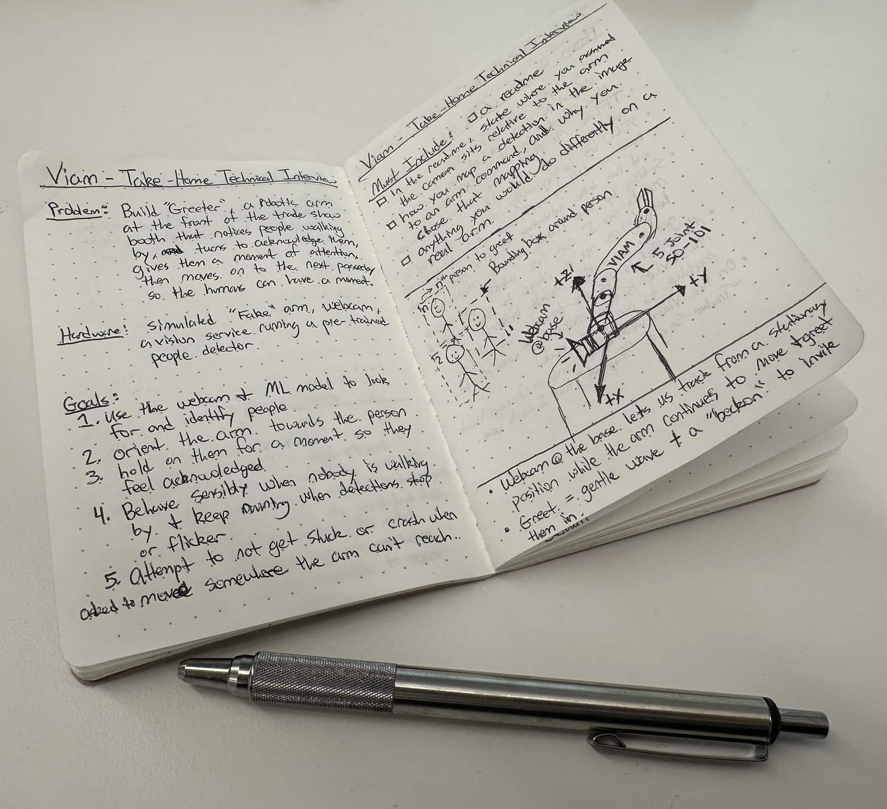
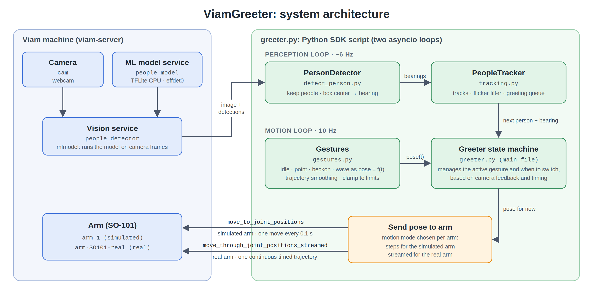
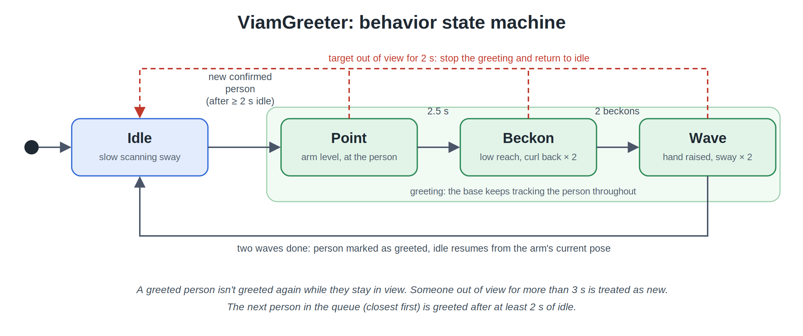

<p align="center">
  
</p>

<h1 align="center">ViamGreeter by Cameron Lerch</h1>

Greeter is an autonomous booth greeter built on the [Viam](https://www.viam.com/) platform. Using a fixed webcam and a pre-trained model to detect and track people passing by a trade show booth, Greeter directs an SO-101 robotic arm to engage with each passerby. The arm turns toward them, points, beckons them over, and waves before moving on to the next person.

It runs on Viam's simulated SO-101 arm and on a real SO-101 arm which can be chosen via a setting in `.env`. The default is a simulated arm.

---

## Quick Start

> [!NOTE]
> You need a Viam machine with a webcam, the people detector and an arm configured (the simulated SO-101 works). See [Prerequisites](#81-prerequisites) and [Machine configuration](#82-machine-configuration) for the exact resources and names.

**1. Install**

```bash
git clone git@github.com:cameron-lerch/ViamGreeter.git
cd ViamGreeter
python3 -m venv .venv
source .venv/bin/activate
pip install -r requirements.txt
```

Rename `.env_example` to `.env`, and replace the API key, API key ID and address using the information provided in the machine's **CONNECT** tab.

`.env` is in `.gitignore`, so credentials never get committed.

```bash
VIAM_API_KEY=<api key>
VIAM_API_KEY_ID=<api key id>
VIAM_MACHINE_ADDRESS=<machine>.viam.cloud
GREETER_ARM=arm-1            # or arm-SO101-real
GREETER_SPEED=1.0            # optional: 0.5 = half-speed gestures (e.g. when running on a real arm)
```

**2. Check the setup (optional)**

Two quick checks before running Greeter. Neither moves the arm.

```bash
python3 connect.py          # lists the machine's resources: confirms the connection and resource names
python3 detect_person.py    # prints live detections: step to your right and the bearing should go positive
```

**3. Run Greeter**

```bash
python3 greeter.py          # the full Greeter (Ctrl-C stops the arm)
```

Watch the arm in the app's **3D SCENE** tab to see a live rendering of the motion. From the 3D Scene tab, select control widgets (top right of the scene) -> people_detector -> toggle the *overview* button to see a live stream of the camera feed with labels from the ML model. Run one script at a time as two scripts commanding the same arm cause interference.

> [!TIP]
> Check out the [simulation demo](#simulated-so-101-viam-3d-scene) or the [real-arm demo](#real-so-101-arm) to see Greeter in action!

---

## Table of contents

1. [Problem Statement and Goals](#1-problem-statement-and-goals)
2. [Approach](#2-approach)
3. [Demo](#3-demo)
4. [System Architecture](#4-system-architecture)
5. [Design Decisions](#5-design-decisions)
6. [How the Requirements are Met](#6-how-the-requirements-are-met)
7. [Repository Structure](#7-repository-structure)
8. [Setup and Usage](#8-setup-and-usage)
9. [Working with a Real Arm](#9-moving-to-a-real-robot)
10. [Shortcomings and Proposed Solutions](#10-shortcomings-and-proposed-solutions)
11. [Lessons for Other Developers](#11-lessons-for-other-developers)
12. [Future work](#12-future-work)
13. [Feedback on Viam](#13-feedback-on-viam)

---

## 1. Problem Statement and Goals

> It's day two of a trade show. The booth staff have been standing for nine hours, their voices are gone, and the coffee ran out at noon. Meet Greeter: a robotic arm at the front of the booth that notices people walking by, turns to acknowledge them, gives them a moment of attention, and then moves on to the next passerby so the humans can sit down for a minute.

Using the Viam Python SDK, write a script with a control loop that lets Greeter:

|  | Requirements |
|---|---|
| 1. | Look for people using the camera and a machine learning model, and orient the arm toward them |
| 2. | Hold on a person for a moment so they feel acknowledged |
| 3. | Behave sensibly when nobody is walking by, and keep running when detections drop out or flicker |
| 4. | Try not to get stuck or crash when asked to move somewhere the arm can't reach |

The README must also state:

|  | Question | *Link to Answer* |
|---|---|---|
| Q1. | Where the camera sits relative to the arm | [§5.1](#51-camera-placement) |
| Q2. | How a detection in the image maps to an arm command, and why | [§5.2](#52-mapping-a-detection-to-an-arm-command) |
| Q3. | What I'd do differently on a real arm | [§9](#9-moving-to-a-real-robot) and [§12](#12-future-work) |

**Additional Goals and Creative Freedom:** make the greeting clear and inviting to a passerby (point, then beckon, then wave), keep every motion smooth, add in a gentle swaying idle sequence, and structure the code so that it could become a deployable Viam module.

---

## 2. Approach

<p align="center">
  
  <br>
  <em>From my notebook: the problem statement, goals, required deliverables, and a sketch of the arm at a trade show.</em>
</p>

My approach to problem-solving is to break a problem down into its simplest components and build up from there. I start by defining the problem statement and identifying the [required deliverables](#1-problem-statement-and-goals), such as this README and a [justification for the camera placement](#51-camera-placement). I then identify smaller, manageable tasks and sketch out the system, whether through a [block diagram of the control scheme](#41-block-diagram) or a drawing of the physical setup (like the notebook sketch above).

With a clearer understanding of the problem and its components, I brainstorm potential solutions for each task, identifying areas where I have creative freedom. There was plenty of room for creative freedom with Greeter:

- how to greet people: [§4.2 Behavior State Machine](#42-behavior-state-machine), [`gestures.py`](gestures.py)
- where to place the camera: [§5.1 Camera Placement](#51-camera-placement)
- how the robot behaves when nobody is around: the *idle* gesture, `idle_pose` in [`gestures.py`](gestures.py)
- which ML model to use for detecting people: [§8.2 Machine configuration](#82-machine-configuration), [`detect_person.py`](detect_person.py)
- how to handle several people in view at once: [§5.4 Tracking and Greeting Queue](#54-tracking-and-greeting-queue), [`tracking.py`](tracking.py)
- how to compute trajectories and command the arm to follow them: [§5.3 Gestures as Functions of Time](#53-gestures-as-functions-of-time), [§9.2](#92-joint-position-motion-commands-simulation-vs-real), [`greeter.py`](greeter.py)

I research existing approaches and evaluate the resources available to me. For this project, I assessed the available hardware and explored the software tools and built-in packages provided by the [Viam Python SDK](https://python.viam.dev/) to determine how to implement the system.

As I experiment with different approaches, I keep a notebook nearby to document my thought process, record assumptions, and track unresolved questions and challenges. This helps me evaluate my decisions, identify shortcomings in my approach, and keep track of questions to revisit as I learn more about the system.

I broke Greeter down into four stages, each tested before moving on to the next:

1. **Perception:** Decide where to place the webcam. Configure the webcam and the ML model for the people detector, and transform bounding boxes from the images into bearings in the robot's frame ([`detect_person.py`](detect_person.py); see [§5.2](#52-mapping-a-detection-to-an-arm-command)).
2. **Tracking:** Track a person as they move through the camera frame, turning the base joint to follow them, and deal with flickering ([`tracking.py`](tracking.py); see [§5.4](#54-tracking-and-greeting-queue)).
3. **Gestures and Queue:** Design the gestures (*idle*, *point*, *beckon*, and *wave*), add a state machine, implement a queue system so each person is only greeted once, and refine the gestures in the 3D scene ([`greeter.py`](greeter.py), [`gestures.py`](gestures.py); see [§4.2](#42-behavior-state-machine) and [§5.3](#53-gestures-as-functions-of-time)).
4. **Real hardware:** Port to a physical SO-101 and investigate the *sim-to-real* gap (see [§9.1 Troubleshooting a real arm](#91-troubleshooting-a-real-arm) and [§9.2](#92-joint-position-motion-commands-simulation-vs-real)).

---

## 3. Demo

### Simulated SO-101 (Viam 3D scene)
[Simulated SO-101](https://github.com/user-attachments/assets/957f2d4b-a655-4539-b3ad-b83c1ff9707a)

**[Simulation Demo Video](media/videos/greeter_sim.mp4)** (`media/videos/greeter_sim.mp4`)

The video opens on the *idle* behavior: a slow, gentle scanning sway while the camera watches for people to pass by. When a person is detected (in the video at ~15 sec), Greeter:

1. **Points** at them with an outstretched arm for a couple of seconds, so it's obvious who is being greeted.
2. **Beckons** them over twice: the hand reaches low toward them and curls up and back.
3. **Waves** at them with a raised hand.
4. **Transitions smoothly back** into the gentle idle sway, picking up the arm's current pose.

Throughout the greeting, the base joint rotates to track the person as they move and all gestures remain centered on the person.

*Not pictured:* Greeter keeps a **queue** of everyone in the scene and greets them one at a time, closest first. It never greets the same person twice, unless they leave the scene for more than a few seconds and come back, in which case they're treated as a new visitor. If a person stays out of view for a couple of seconds during their greeting, the greeting stops and Greeter returns to idle, or moves on to the next person. (Exact timings are in [§5.4](#54-tracking-and-greeting-queue).)

### Real SO-101 Arm

[Real SO-101 Arm](https://github.com/user-attachments/assets/657e7ac3-a07f-4b7f-a611-5bbc258ccf20)

**[Real-arm Demo Video](media/videos/greeter_real.mp4)** (`media/videos/greeter_real.mp4`)

The physical SO-101 runs the same Greeter behavior (*idle*, *point*, *beckon*, *wave*), driven by the same code. The differences are the real-arm settings described in [§9](#9-moving-to-a-real-robot):
- the trajectory is planned with a certain buffer into the future and the joint positions are *streamed* as one continuous timed trajectory instead of sending individual joint position commands.
- the wave on the real robot does not extend as high vertically to increase stability in the movement.
- the real wrist is 90° offset compared to the simulation.

Some slight shaking remains due to a combination of play in the gears and the arm being made from 3D printed materials (see [§9.1 Troubleshooting a real arm](#91-troubleshooting-a-real-arm) and [§9.3](#93-real-arm-settings)).

---

## 4. System Architecture

### 4.1 Block Diagram

<p align="center">
  
</p>

Two loops run asynchronously:

- **Perception (~6 Hz):** camera → detector → tracker. The camera is fixed, so it keeps watching while the arm moves.
- **Motion (10 Hz):** the state machine picks the active motion, samples it at the current time, applies trajectory smoothing between gestures, clamps to joint limits, and sends motion commands to the arm.

### 4.2 Behavior State Machine

<p align="center">
  
</p>

| State | What the arm does |
|---|---|
| **Idle** | Slow scanning sweep: each joint follows a sine wave with a different period, so the base sweeps side to side while the shoulder, elbow, and wrist bob on different rhythms. |
| **Point** | Arm stretched out level toward the person, so it's obvious who is being greeted. |
| **Beckon** | Hand low and forward before curling back to suggest "come over here" to the person being greeted. |
| **Wave** | Hand raised as the base sways side to side and the wrist rocks, resulting in a wave. |

During every gesture, the base joint tracks the person as they walk. 

---

## 5. Design Decisions

### 5.1 Camera Placement

**Assumption:** the webcam is mounted at the base of the arm, fixed to the pedestal (it doesn't rotate with joint 1), with its optical axis along the arm's +x-axis (base joint at 0°), and its image "up" along the +z-axis.

Why a fixed camera instead of one on the wrist:

- **Enables Greeter to greet and look for new people.** Greeter can greet the current person (*point*->*beckon*->*wave*) and simultaneously scan the scene for new people to greet and add them to the queue.
- **Simplifies the mapping.** With a fixed image along the x-axis, it simplifies the problem so I don't have to map the camera image to the world-frame with every movement of the arm. A wrist-mounted camera would see the whole scene shift every time the arm moved, and every detection would need correcting.
- **Simplifies tracking and enables fancier movements.** A fixed camera also loosens constraints on the motion so that Greeter can move freely without needing to ensure that the person we're greeting remains in the camera's field of view the entire time. Similarly, it also makes managing the queue of people to greet simpler. 

### 5.2 Mapping a Detection to an Arm Command

Each person's bounding-box center `(u, v)` becomes a *bearing* with a [pinhole camera model](https://en.wikipedia.org/wiki/Pinhole_camera_model). The focal length in pixels comes from the camera's horizontal field of view (`CAMERA_HFOV_DEG`, 70° for a Logitech C920 at 16:9):

```math
f = \frac{W/2}{\tan\left(\dfrac{\mathrm{HFOV}}{2}\right)}
```

```math
\theta_{\text{bearing}} = -\arctan\left(\frac{u - W/2}{f}\right)
```

```math
\theta_{\text{base}} = -\,\theta_{\text{bearing}}
```

| Symbol | Meaning | Unit |
|---|---|---|
| $f$ | Focal length of the camera, in pixels | px |
| $W$ | Image width | px |
| $\mathrm{HFOV}$ | Camera's horizontal field of view (`CAMERA_HFOV_DEG`) | degrees |
| $u$ | Horizontal pixel position of the bounding-box center | px |
| $W/2$ | Horizontal center of the image | px |
| $u - W/2$ | How far the person is from the image center (positive = right side of the image) | px |
| $\theta_{\text{bearing}}$ | Person's direction from the camera axis (+x); positive = to the camera's left (counter-clockwise, seen from above) | degrees |
| $\theta_{\text{base}}$ | Base joint command sent to the SO-101. The sign flips because a positive base angle turns the arm clockwise (to its right). | degrees |

Angles are in degrees. The code converts $\mathrm{HFOV}$ to radians for $\tan$, and converts the $\arctan$ result back to degrees (`pixel_to_direction` in `detect_person.py`).

**Derivation**
- **Bearing:** the [camera matrix](https://en.wikipedia.org/wiki/Camera_matrix) projects a point at sideways offset $X$ and depth $Z$ (camera coordinates) to the horizontal pixel $u = f\,\frac{X}{Z} + c_x$, where $c_x$ is the principal point, the pixel the camera axis passes through. Solving for the angle gives $\theta = \arctan\left(\frac{u - c_x}{f}\right)$, with the principal point $c_x$ taken as the image center $W/2$.
- **Focal length:** the [angle of view](https://en.wikipedia.org/wiki/Angle_of_view) formula $\alpha = 2\arctan\left(\frac{d}{2f}\right)$, solved for $f$, with the sensor width $d$ measured in pixels ($W$) and $\alpha = \mathrm{HFOV}$.
- **Minus sign:** Adjustment for the camera's +X points right, but the world frame's +y points left and bearings are positive counter-clockwise.

These equations assume: square pixels, the *principal point* is at the image center, and no lens distortion. If we wanted or needed to increase accuracy, we could perform a camera calibration to measure $f$, $c_x$ and the distortion directly, though the assumptions made here were good enough for accurate person tracking with a webcam. 

Elevation is computed in the same way using `v`, but is not yet used for aiming. 

**Why this mapping:**

- **Only the base needs to aim.** With a camera at the base, "orienting toward a person" is a rotation about the vertical axis, mapping directly to the base joint.
- **It works with any resolution or camera.** Image size is read from every frame, so a different camera only needs its field of view (and `MIRRORED`, if the image is flipped).
- **Joint angles instead of 3D targets.** Viam can also move an arm to a 3D position (x, y, z) using its motion planner, which solves inverse kinematics to find the joint angles. But a single webcam tells us only *which direction* a person is in, not *how far away* they are, so any 3D target would rest on a guessed distance. Greeter instead computes the joint angles itself and sends them directly using Viam's joint position commands. After clamping to the joint limits, every command is reachable by construction.

### 5.3 Gestures as Functions of Time

*Idle*, *point*, *beckon* and *wave* are each a function of time, `pose = f(t)` in `gestures.py`. On every tick of the motion loop ([§4.1](#41-block-diagram)), the controller asks the active motion where the arm should be in that instant. This gives:

- **Instant interruption.** *idle* is only sampled, never left running, so it can stop the moment someone appears.
- **Smooth trajectories between gestures.** Every change in gesture (*idle*, *point*, *beckon*, or *wave*) uses trajectory smoothing from the arm's actual pose, following a smoothstep curve that ties the motion together smoothly. Returning to idle resumes at the point on the idle path nearest the arm's current pose, so the arm never swings across to a distant point.
- **Continuous tracking.** The person's bearing feeds into every gesture.
- **Safety via joint limits.** Every pose passes through `clamp_pose()`: joint limits from the arm's kinematics, minus a 5° margin, with the shoulder further capped so the arm never reaches down into the table. 
- **Speeds checked offline.** Each gesture's own motion is designed to stay within the arm's speed limit (measured peaks are in [§9.3](#93-real-arm-settings)).

### 5.4 Tracking and Greeting Queue

The detector only reports "a person at this bearing" each frame; it doesn't know *which* person. `tracking.py` gives people an identity by matching each frame's detections to existing tracks by nearest bearing (within 12°).

| Rule | Value | Purpose |
|---|---|---|
| Confirm a new track | 3 frames (~0.5s) | Ignore one-frame false detections |
| Eligible to greet | confirmed, not yet greeted, seen in the last 0.6s | Avoids turning toward someone who leaves the field of view |
| Queue order | Closest first (largest box), re-checked every time | Prioritizes people near the booth |
| Between greetings | At least 2s of idle | Makes moving from one person to the next look more deliberate. |
| Target lost mid-greeting | Not seen for 2s → end the greeting, mark as greeted | Avoids waving at empty space |
| Forget a track | Not seen for 3s | Gives a buffer to ensure movement continues even if flickers occur and also gives an out if the person has left the scene. |
| Greeted and still present | do not greet | Avoids greeting the same person multiple times |

---

## 6. How the Requirements are Met

| Requirement | Implementation | Where |
|---|---|---|
| **1** Look for people and orient toward them | Uses the `people_detector` vision service. Each bounding box becomes a bearing that is smoothly followed | `detect_person.py`, `greeter.py` (`desired_pose`) |
| **2** Hold on a person so they feel acknowledged | Points at the person, then beckons twice and waves, with every motion oriented toward them | `greeter.py`, `gestures.py` |
| **3** Behave sensibly when nobody is there | Implemented a gentle idle sequence when no people are detected. | `gestures.idle_pose`, `Greeter.start_idle` |
| **3** Robust to dropouts and flicker | A new person must be seen in several consecutive frames, short dropouts are tolerated before a track is dropped, and a greeting only ends if the person stays out of view (values in [§5.4](#54-tracking-and-greeting-queue)). Detection errors are logged and the loop continues. | `tracking.py`, `Greeter.perceive` |
| **4** Don't get stuck or crash on unreachable poses | Joint-space commands only, clamped to the arm's kinematic limits with a safety margin (plus extra room for the table), so every command is reachable | `gestures.clamp_pose` |

---

## 7. Repository Structure

```
ViamGreeter/
├── greeter.py          # Main program: the control loop and state machine
├── gestures.py         # Gestures as pose = f(t); trajectory smoothing, clamping, joint limits
├── tracking.py         # Turns detections into tracks; flicker filter; greeting queue
├── detect_person.py    # Vision service → people with bearings
├── connect.py          # Connects to the machine using credentials from .env, useful for testing connection
├── requirements.txt    # Python dependencies
├── media/
│   ├── diagrams/       # Architecture and state-machine diagrams
│   ├── images/         # Header image, notes and sketches
│   └── videos/         # Demo videos
└── problem_statement.txt
```

| File | Summary |
|---|---|
| **`greeter.py`** | Main file. The `Greeter` class runs two concurrent loops: **perception** (detector → tracker) and **motion** (state machine → arm). The state machine manages the active gesture (*idle*, *point*, *beckon* or *wave*) and when to switch to a new one, based on camera feedback and timing. It also handles the motion clock, trajectory smoothing between gestures, and settings for each arm. It sends motion either as single joint commands for a simulated arm or as streamed joint commands for a real arm, and recovers from arm errors without crashing. |
| **`gestures.py`** | Pure functions with no SDK dependency. They return 5 joint angles `[base, shoulder, elbow, wrist pitch, wrist roll]` for a given time: `idle_pose`, `point_pose`, `beckon_pose`, `wave_pose`. Also holds the joint limits and `clamp_pose`, the `smoothstep` function for trajectory smoothing, and `nearest_idle_time` for resuming idle smoothly. |
| **`tracking.py`** | `PeopleTracker` matches each frame's detections to `Track`s by bearing, confirms new tracks, forgets stale ones, keeps the `greeted` flag, and returns `next_target()`, the closest eligible person. |
| **`detect_person.py`** | `PersonDetector.detect()` gets one image and its detections from the vision service in a single call, keeps confident `person` detections, and converts each to bearing and elevation with `pixel_to_direction()`. Can be run directly to print live detections and per-frame latency. |
| **`connect.py`** | `connect()` reads the API key and machine address from `.env`. Can be run directly to list the machine's resources as a connection check. |

---

## 8. Setup and usage

Install and run steps are in [Quick Start](#quick-start) at the top of this README. This section covers what the machine needs and what you can tune.

### 8.1 Prerequisites

- Python 3.11+ (developed on 3.14)
- A Viam machine running `viam-server` on the computer the webcam is plugged into
- A webcam
- A physical SO-101 arm (optional)

### 8.2 Machine configuration

Configure these in the Viam app (**CONFIGURE** tab). The code looks resources up *by name*, so the names must match.

| Name | Type | Model / notes |
|---|---|---|
| `cam` | Camera | `webcam`; set `video_path` if it isn't detected automatically |
| `people_model` | ML model | **TFLite CPU**, deploying the **EfficientDet-COCO** model by viam-labs from the registry |
| `people_detector` | Vision service | **`vision/mlmodel`** block. ML model: `people_model`, default camera: `cam` |
| `arm-1` | Arm | Simulated SO-101 (from the `devrel/so101-arm` module) |
| `arm-SO101-real` | Arm | *Optional.* Physical SO-101 (same module); see [§9.3](#93-real-arm-settings) |

### 8.3 Tuning

| Setting | File | Default | Effect |
|---|---|---|---|
| `CAMERA_HFOV_DEG`, `MIRRORED` | `detect_person.py` | 70°, `False` | Camera model; set these when changing webcams |
| `MIN_CONFIDENCE` | `detect_person.py` | 0.5 | Detection threshold |
| `POINT_S`, `TRANSITION_S`, `WAVE_SMOOTH_S` | `greeter.py` | 2.5s, 1.5s, 1.2s | Greeting timing |
| `MIN_IDLE_S`, `LOST_S`, `BASE_FOLLOW` | `greeter.py` | 2s, 2s, 0.2 | Pacing and how closely the base follows |
| `MATCH_GATE_DEG`, `CONFIRM_HITS`, `FORGET_S` | `tracking.py` | 12°, 3, 3s | Tracking and flicker tolerance |
| Poses and periods (`POINT`, `RAISED`, `REACH`, `IDLE_CENTER`, ...) | `gestures.py` | | Gesture shape (amplitudes and periods) |

---

## 9. Moving to a real robot

I initially expected the move from simulation to a real arm to need **some tuning**: speeds, timings, maybe a few poses. What I didn't expect was a **structural change in how the code sends motion to the arm**. The real arm needed continuous streams of joint positions instead of one joint position at a time in order to achieve smooth motion. [§9.1](#91-troubleshooting-a-real-arm) walks through each problem I troubleshot on the real arm, its root cause and the fix. 

### 9.1 Troubleshooting a real arm

| Symptom on the real arm | Root cause | Fix |
|---|---|---|
| **Very jerky motion**: the servos started and stopped several times a second, joints sometimes moved one at a time, and gestures ran slowly | The motion loop sent a new target on every tick using `move_to_joint_positions`. The simulated arm accepts each one instantly, but on the real arm each call is a complete move that starts and ends at rest. | Switched the real arm to `move_through_joint_positions_streamed`: one continuous, timestamped trajectory. See [§9.2](#92-joint-position-motion-commands-simulation-vs-real). |
| The arm module kept dropping bytes from the servos (`communication error during sync_read: read 40 of 48 expected bytes`), and joint reads and moves failed | USB contention. The webcam was plugged into the same USB dongle as the arm's serial adapter. The 1080p video stream filled the shared USB link, so replies from the servo bus arrived incomplete and the module timed out. | Moved the webcam to its own USB port. |
| Shaking at the top of the wave | The play between the gears, the hobby-grade servos, and the plastic links of the real SO-101 led to shaking when the arm was fully extended | Reduced the *wave* gesture's extension on the real arm |
| Hand oriented in the wrong direction | Wrist joint differs between the simulated and real arm | Adjusted the wrist joint to be 90° in simulation and 0° on the real arm |

All real-arm differences are keyed to the **arm name** (`HAND_ROLL_BY_ARM`, `WAVE_RAISED_BY_ARM`, `MOTION_BY_ARM` in `greeter.py`). The simulated arm keeps its original behavior, and `GREETER_ARM` is the only switch.

### 9.2 Joint Position Motion Commands: Simulation vs. Real

The gestures, state machine, tracking and pose calculation are all identical for both arms, but the joint position commands to each arm differ.

| | Simulated arm (`steps` mode) | Real SO-101 (`streamed` mode) |
|---|---|---|
| **SDK call** | `arm.move_to_joint_positions(...)`, called again on every motion-loop tick | `arm.move_through_joint_positions_streamed(...)`, one call kept open for the whole run |
| **What each pose becomes** | A separate "go to these joint angles" command | An `Arm.TrajectoryPoint` with a timestamp 0.3 s ahead (`STREAM_LEAD_S`) |
| **Code** | `Greeter.move()` | `Greeter.move_streamed()` |
| **Selected by** | Default for any arm | `MOTION_BY_ARM = {"arm-SO101-real": "streamed"}` |

**Why the simulated arm uses `move_to_joint_positions`:** it's the simplest way to command an arm: send a set of joint angles, and the arm moves to them. The simulated arm carries out each command instantly, so sending ten small moves per second produces motion that looks perfectly smooth in the 3D scene.

**Why that failed on the real arm:** on the physical SO-101, every `move_to_joint_positions` is a complete move. The servos accelerate, slow down, stop, and then report that they've reached their goal. Sending one on every tick made the servos start and stop several times a second, which produced very jerky motion.

**The three options I compared on the real arm:**

| Option | Result |
|---|---|
| `move_to_joint_positions`, once per tick | Jerky stop-start motion and slow gestures (see [§9.1 Troubleshooting a real arm](#91-troubleshooting-a-real-arm)) |
| `move_through_joint_positions`, the whole wave as one waypoint list | Much smoother than `move_to_joint_positions` because the module doesn't stop at each waypoint. But a plain waypoint list has no timing, so the arm ran a 4 s wave in 2.6 s at its own speed (the speed could be capped or stretched to roughly match the timing, but there is no inherent timing command). The list is also fixed before it starts, so the base can't keep tracking a moving person. |
| `move_through_joint_positions_streamed`, timestamped points generated live | This option resulted in the smoothest motion. The servos never stop between points and it keeps the gesture's timing, because each point has a timestamp. The base joint continues to track the person through gestures because the stream of points is computed from the latest detections as the stream runs. |

### 9.3 Real-arm settings

SO-101 arm module attributes (set in the Viam app, not in code) that gave the best motion:

```json
{
  "port": "/dev/ttyACM1",
  "speed_degs_per_sec": 120,
  "waypoint_lookahead_deg": 20,
  "acceleration_degs_per_sec_per_sec": 500
}
```

- **`speed_degs_per_sec`: raised from the default 50 to 120.** At 50°/s the servos couldn't reach the joint positions Greeter was commanding in time: the beckon peaks at about 59°/s and the rise into the wave at about 91°/s, so the arm fell behind the gestures.
- **`waypoint_lookahead_deg`: 20.** How far ahead of the arm the module writes the next servo goal during a stream. A larger value means the servos never slow down to wait for the next point. This setting had the largest impact when smoothing out the arm motion. 
- **`acceleration_degs_per_sec_per_sec`: 500,** the maximum the servos support.
- **`port`** varies by machine.

---

## 10. Shortcomings and proposed solutions

Known gaps in the current version, and how I'd address each with more time or resources.

| Shortcoming | Impact | Proposed solution |
|---|---|---|
| **Losing or swapping people who cross paths.** Tracks are matched only by bearing (direction). | When two people cross, their identities can swap: Greeter may switch to the wrong person mid-greeting, or think the greeted person is new. | **Remember what each person looks like**, such as a face or clothing appearance embedding, and match on that as well as position. This is more intensive than I felt like was necessary for this project. It needs an extra model running on every detection, storage for everyone who has appeared, and care around privacy at a public event. A cheaper first step could be to implement matching on box overlap (IoU) with a Kalman filter that predicts each person's motion, which handles most crossings. |
| **Re-greeting someone who lingers.** A track is forgotten after 3 s without detections. | A person standing still whose detection drops out briefly (bad angle, occlusion) can be greeted again. | Keep greeted tracks much longer than ungreeted ones. The proposed solution above solves it properly. |
| **Direction but no distance.** One webcam gives no depth, so only the base aims. | The arm points toward a person but not at their height or distance. Box size is a rough stand-in for distance, so a tall adult far away can rank as "closer" than a child near the booth. | Use the elevation (already computed) to aim the shoulder and wrist pitch, or add a **depth camera** for true 3D positions and distance-based priorities. |
| **Camera placement is assumed, not measured.** | Any offset or rotation between the camera and the arm's 0° becomes an aiming error on real hardware. | **Calibrate automatically:** the arm holds an orientation plate in its gripper and sweeps the base until the camera sees the plate square-on; that base angle defines the camera's axis (the new +x). Store the result in Viam's **frame system** and transform bearings through it. |
| **The arm can block the camera.** On the real arm, gestures sometimes pass in front of a base-mounted camera. | Detections can drop or jump mid-gesture, so tracking may briefly freeze. | Mount the camera higher or off to one side (with the offset in the frame system), or ignore detections in the image region the arm covers during a gesture. |
| **Closest-first can make people wait a long time.** | In a crowd, someone farther away may never reach the front of the queue. | Score the queue on proximity and waiting time, and favor people approaching the booth (box growing) over people walking past. |
| **Real-arm motion is at the hardware's limit.** | The SO-101 is a low-cost arm: gear play in its hobby servos and flex in its plastic links make it wobble, especially when extended, and the fastest transition is near its speed cap. | Generate smoother trajectories (splines), check each one against the configured speed and acceleration before sending, keep poses away from full extension, or move to an arm with stiffer links and higher-quality servos. |
| **False positives from static people-like objects.** | A poster or mannequin detected as a person would be greeted. | Ignore tracks that never move, or require some motion before a track becomes eligible. |
| **Runs as a laptop script.** | If the laptop sleeps or the script crashes, Greeter stops until someone restarts it. | Package it as a **Viam module** (generic service) so `viam-server` supervises and restarts it and its settings appear in the app. |

---

## 11. Lessons for Other Developers

What I learned moving Greeter from simulation to a real arm (see [§9](#9-moving-to-a-real-robot)), for anyone attempting something similar:

- Single commands work in simulation; a real arm needs a stream. Sending one joint position at a time is fine on the simulated arm, but smooth motion on a real arm needs a continuous stream of timed joint positions.
- Design around the hardware's mechanical limits. A low-cost arm with plastic links and hobby servos flexes and has gear play, so poses that keep the servos loaded (like the bent-elbow wave) behave better than fully extended ones.
- Hardware layout is part of the system. A webcam on the same USB dongle as the arm was enough to corrupt communication. Give high-bandwidth devices their own USB controller.
- Check the module and server logs (`viam-agent`), not only the client errors. They pointed at the servo bus issue.
- Keep the simulated arm configured next to the real one, so changes can always be checked against simulation.

---

## 12. Future work

**Perception and tracking**
- [ ] Compare detectors (YOLOv8 on the GPU, `effdet0`) for accuracy, flicker and latency
- [ ] Give priority to people *approaching* the booth (box growing) over people walking past
- [ ] Utilize a more powerful model to keep an overall list of unique people that have been greeted throughout the day (such as looking at clothing or facial recognition) which would help with the issue of target swappying when two people overlap.

**Aiming and behavior**
- [ ] Use elevation and box size to aim the shoulder and wrist at the person's height and distance
- [ ] Add a depth camera for true 3D positions
- [ ] Automatic camera-to-arm calibration instead of assuming where the camera is: the arm holds an orientation plate in its gripper and makes small calibration moves while the camera tracks it, and the result is stored in Viam's frame system. The camera could then be mounted anywhere stationary and the arm would still aim correctly.
- [ ] More gesture variety could be a fun addition.
- [ ] Adjust the queue to include wait times along with positions so that people don't wait for too long.

**Real hardware**
- [ ] Smoother trajectory generation and an adaptive stream lead
- [ ] Safety layer: slow down when people are close, workspace obstacles, a software emergency stop

**Engineering**
- [ ] Package Greeter as a **Viam module** running on the computer next to the arm, with config attributes and dependencies on the arm and vision service. `viam-server` would then supervise it and restart it after crashes or reboots, the registry could ship it to every booth, its settings would appear in the app, and running several Greeter arms at once would be straightforward
- [ ] Move tuning constants into one config file, or module attributes

---

## 13. Feedback on Viam

### What worked well

- **Getting a simulated robot running was quick and easy.** A simulated SO-101, a webcam and a people detector were all set up from the app, and the 3D scene made it easy to see exactly what the code was doing and to refine the gestures before touching hardware.
- **Swapping ML models was quick and painless.** The ML model service and vision service made it easy to swap out a model and try a different one: the code only talks to `people_detector`, so changing models is a config change in the app, with no code change.
- **The same code drove both the simulated and the real arm.** Moving to hardware needed tuning and one change in how motion is sent, not a full rewrite of the code base.
- **`move_through_joint_positions_streamed` was the right tool for smooth motion on the real arm,** and the SO-101 module's attribute documentation (speed, acceleration, waypoint lookahead) made it clear what to tune.
- **Logs pointed in the right direction.** The `viam-agent` logs showed the servo bus errors which helped me more easily troubleshoot the issue.

### Issues and suggestions

| Area | What I ran into | Suggestion |
|---|---|---|
| **Broken link** | On the SO-101 arm module (**SO101-Arm → details panel → arm setup link**), and in other places I found that some hyperlinks are broken. | Fix the links, or point them to the current setup guide. |
| **Choosing an ML model** | The registry lists many similar people and COCO detectors (for example `effdet0` by bill and `EfficientDet-COCO` by viam-labs), with little documentation explaining how they differ or which is recommended. | A comparison table or "recommended" badges, plus labels, input size and benchmark numbers on each model page. Being able to sort through which models run on CPU vs GPU could also be helpful. |
| **Simulation vs. real arms** | The simulated arm accepts commands instantly and ignores `MoveOptions.max_vel_degs_per_sec`, so a design that sends many small moves looks perfect in simulation but is jerky on real servos. | The simulation environment through Viam is less of a simulation and more of a visualization, and as a result there were large changes in the behavior on a real arm. Offering a full physics simulation environment online would be computationally costly but could be very useful. |
| **Two clients, one arm** | Two scripts commanding the same arm silently cancel each other's moves (`context canceled`), which was confusing to debug. | A clearer error that says another client is controlling the arm could be helpful. |
| **Disabled resources** | A resource disabled in the app doesn't exist as far as the SDK is concerned, and an unsaved change after re-enabling it could look like a code problem. | Specifically mention that a resource might be disabled when the "resource not found" error is thrown. |

